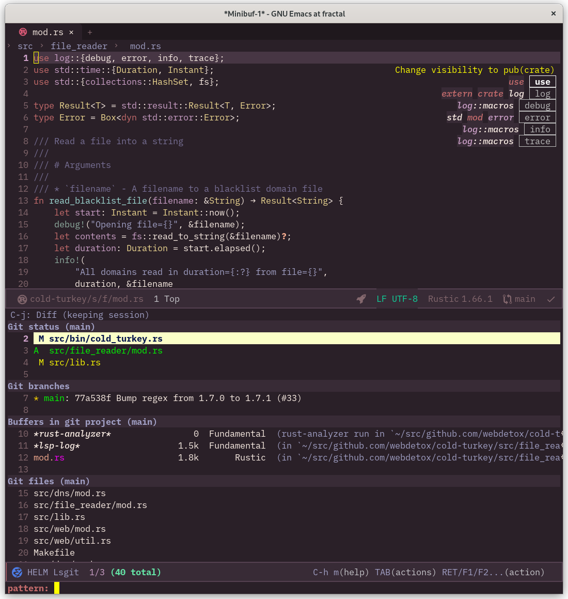

# emacs.d

#### An opinionated Emacs configuration.
<p>
	<a href="https://github.com/otype/emacs.d/commits/main">
	
    <a href="https://github.com/otype/emacs.d/issues">
    
    <a href="https://github.com/otype/emacs.d/pulls">
    
	<a href="https://github.com/otype/emacs.d/blob/main/LICENSE">
	
</p>

Emacs.d is an opinionated [Emacs](https://www.gnu.org/software/emacs/) configuration based on [use-package](https://jwiegley.github.io/use-package/), [helm](https://emacs-helm.github.io/helm/) (& various addons), [projectile](https://docs.projectile.mx/projectile/index.html), [flycheck](https://www.flycheck.org/en/latest/) and [smartparens](https://github.com/Fuco1/smartparens). For the looks, it uses [dashboard](https://github.com/emacs-dashboard/emacs-dashboard), [centaur-tabs](https://github.com/ema2159/centaur-tabs), [doom-modeline](https://seagle0128.github.io/doom-modeline/), the current [Omarchy](https://omarchy.org) theme and [all-the-icons](https://github.com/domtronn/all-the-icons.el).

For coding, it provides [magit](https://magit.vc/) (with [forge](https://magit.vc/manual/forge/)), [lsp-mode](https://emacs-lsp.github.io/lsp-mode/) with [lsp-ui](https://github.com/emacs-lsp/lsp-ui), and [org-mode](https://orgmode.org/) with [org-modern](https://github.com/minad/org-modern) and [org-roam](https://www.orgroam.com/). Language support is configured per file — active languages are [Go](/elisp/lang-go.el), [JavaScript](/elisp/lang-javascript.el), [Lisp](/elisp/lang-lisp.el), [Python](/elisp/lang-python.el), [Rust](/elisp/lang-rust.el) and [Terraform](/elisp/lang-terraform.el). Additional configurations for [Elixir](/elisp/lang-elixir.el), [Haskell](/elisp/lang-haskell.el), [Java](/elisp/lang-java.el), [Ruby](/elisp/lang-ruby.el) and [Vala](/elisp/lang-vala.el) are available but disabled by default.

All language layers use [lsp-mode](https://emacs-lsp.github.io/lsp-mode/) as the unified backend for completions, diagnostics, code actions, and navigation — with [company](https://company-mode.github.io/) for the completion frontend. Python uses [lsp-pyright](https://github.com/emacs-lsp/lsp-pyright) with [blacken](https://github.com/proofit404/blacken) for formatting.

## Preview

Here are some sample screenshots:

<p float="left">
	
	
	
</p>

## Getting started

#### Requirements

- [Emacs](https://www.gnu.org/software/emacs/) v30 or higher (the `:vc` keyword of `use-package` is used)
- [git](https://git-scm.com/) and `curl`
- Font [Liberation Mono](https://github.com/liberationfonts/liberation-fonts)
- [Ag - The Silver Searcher](https://github.com/ggreer/the_silver_searcher)
- Language servers for your active language layers:
  - [gopls](https://pkg.go.dev/golang.org/x/tools/gopls) — Go
  - [rust-analyzer](https://rust-analyzer.github.io/) — Rust
  - [pyright](https://github.com/microsoft/pyright) — Python (`pip install pyright`)
  - [elixir-ls](https://github.com/elixir-lsp/elixir-ls) — Elixir (only if you enable the layer)
  - [terraform-ls](https://github.com/hashicorp/terraform-ls) — Terraform (optional)

#### Installation

One command clones the configuration to `~/.emacs.d`, takes your name and email for [user.el](/elisp/user.el) from `git config`, and installs all Emacs packages:

```console
$ curl -fsSL https://raw.githubusercontent.com/otype/emacs.d/main/install.sh | bash
```

Prefer to read the script first?

```console
$ curl -fsSLO https://raw.githubusercontent.com/otype/emacs.d/main/install.sh
$ less install.sh
$ bash install.sh
```

The installer is safe to run again: it fast-forwards an existing clone, leaves a checkout with local changes alone, and moves any other existing `~/.emacs.d` to `~/.emacs.d.bak-<timestamp>` before cloning. Options (append them to the pipe with `bash -s -- <options>`):

| Option | Effect |
|---|---|
| `--check` | Report what would change and change nothing (exit 1 if anything would) |
| `--no-packages` | Skip the headless package installation; packages then install on the first start of Emacs |
| `--name NAME`, `--email EMAIL` | Set `user-full-name` and `user-mail-address` instead of using `git config` |

It only warns about missing extras (Liberation Mono, `ag`, language servers) and never installs system packages.

After installing, enable more languages by uncommenting the `(require 'lang-…)` lines in [init.el](/init.el) (check each file in [/elisp/](/elisp/) for its dependencies), then start `emacs`.

<details>
<summary>Manual installation</summary>

```console
$ git clone https://github.com/otype/emacs.d.git ~/.emacs.d
$ $EDITOR ~/.emacs.d/elisp/user.el   # your name and email
$ $EDITOR ~/.emacs.d/init.el         # enable language layers
$ emacs                              # installs all packages on first start
```

</details>

## Key bindings reference

### Helm (`C-c h …`)
| Binding | Command |
|---|---|
| `M-x` | `helm-M-x` |
| `C-x C-f` | `helm-find-files` |
| `C-x b` | `helm-mini` (buffer switcher) |
| `M-y` | `helm-show-kill-ring` |
| `C-c h a` | `helm-projectile-ag` |
| `C-c h b` | `helm-filtered-bookmarks` |
| `C-c h d` | `helm-do-ag` |
| `C-c h g` | `helm-browse-project` |
| `C-c h i` | `helm-semantic-or-imenu` |
| `C-c h k` | `helm-show-kill-ring` |
| `C-c h m` | `helm-mini` |
| `C-c h o` | `helm-occur` |
| `C-c h r` | `helm-resume` |
| `C-c h v` | `helm-projectile` |

### LSP (`C-c l …`)
| Binding | Command |
|---|---|
| `C-c l r` | `lsp-rename` |
| `C-c l a` | `lsp-execute-code-action` |
| `C-c l f` | `lsp-format-buffer` |
| `C-c l d` | `lsp-describe-thing-at-point` |
| `C-c l l` | `lsp-ui-flycheck-list` |

### Magit (`C-c m …`)
| Binding | Command |
|---|---|
| `C-c m b` | `magit-branch-and-checkout` |
| `C-c m c` | `magit-commit` |
| `C-c m d` | `magit-diff-unstaged` |
| `C-c m e` | `magit-ediff-resolve` |
| `C-c m f` | `magit-fetch` |
| `C-c m l` | `magit-log-current` |
| `C-c m p` | `magit-push` |
| `C-c m r` | `magit-rebase-interactive` |
| `C-c m s` | `magit-status` |
| `C-c m u` | `magit-pull` |
| `C-c m x` | `magit-checkout` |

### Org (`C-c o …`)
| Binding | Command |
|---|---|
| `C-c o a` | `org-agenda` |
| `C-c o c` | `org-capture` |
| `C-c o s` | `org-store-link` |

### Org-roam (`C-c r …`)
| Binding | Command |
|---|---|
| `C-c r f` | `org-roam-node-find` |
| `C-c r g` | `org-roam-graph` |
| `C-c r l` | `org-roam-buffer-toggle` |
| `C-c r r` | `org-roam-node-random` |
| `C-c r a` | `org-roam-alias-add` (org buffers) |
| `C-c r c` | `completion-at-point` (org buffers) |
| `C-c r d` | `org-roam-dailies-capture-today` (org buffers) |
| `C-c r e` | `org-roam-capture` (org buffers) |
| `C-c r i` | `org-roam-node-insert` (org buffers) |
| `C-c r o` | `org-id-get-create` (org buffers) |
| `C-c r t` | `org-roam-tag-add` (org buffers) |
