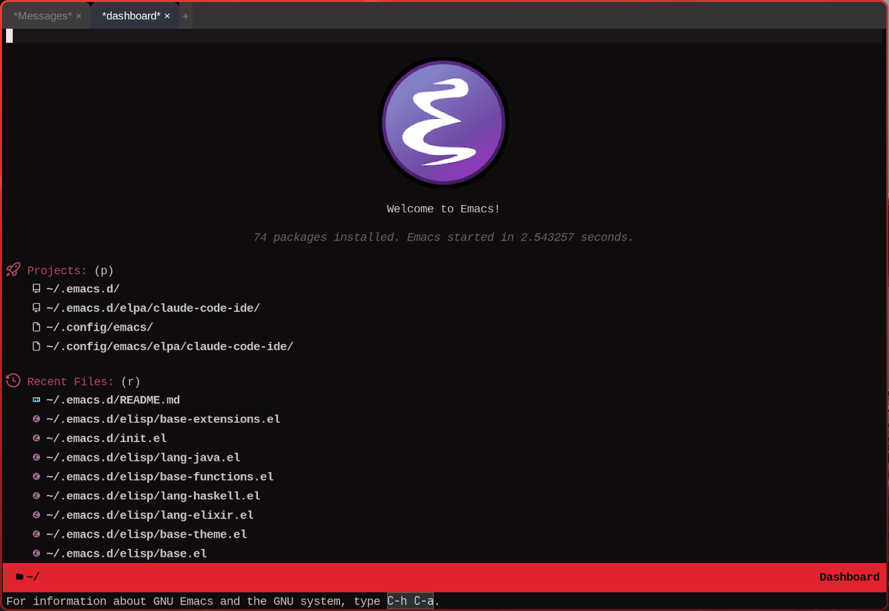
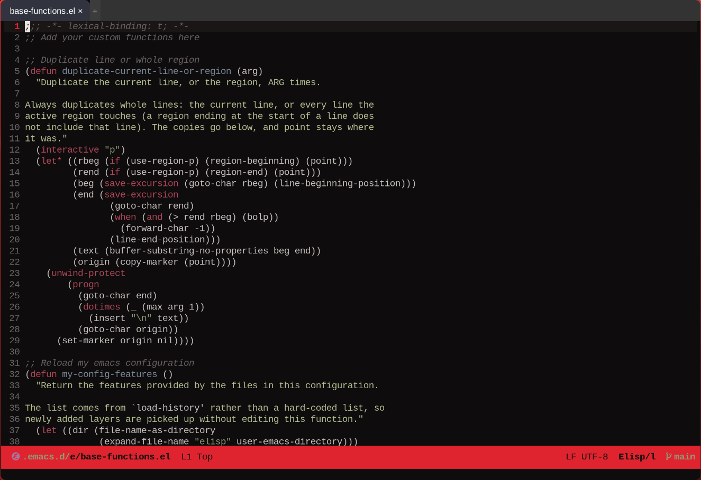
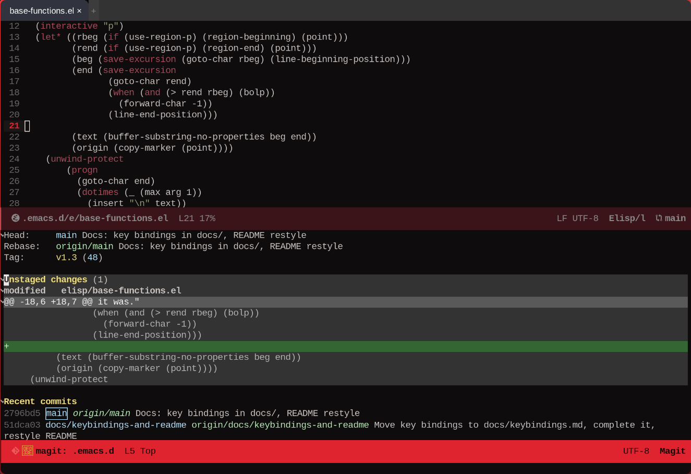

<h1 align="center">🧩 emacs.d</h1>

<p align="center"><b>An opinionated Emacs configuration.</b></p>

<p align="center">
  <a href="https://github.com/otype/emacs.d/commits/main">
    
  </a>
  <a href="https://github.com/otype/emacs.d/issues">
    
  </a>
  <a href="https://github.com/otype/emacs.d/pulls">
    
  </a>
  <a href="https://github.com/otype/emacs.d/blob/main/LICENSE">
    
  </a>
  <a href="https://www.gnu.org/software/emacs/">
    
  </a>
</p>

<p align="center">
  <a href="#-highlights">Highlights</a> ·
  <a href="#-preview">Preview</a> ·
  <a href="#-getting-started">Getting started</a> ·
  <a href="#-key-bindings">Key bindings</a> ·
  <a href="#-project-layout">Layout</a>
</p>

---

## ✨ Highlights

- 🧱 **Foundation:** [use-package](https://jwiegley.github.io/use-package/), [helm](https://emacs-helm.github.io/helm/) (& various addons), [projectile](https://docs.projectile.mx/projectile/index.html), [flycheck](https://www.flycheck.org/en/latest/) and [smartparens](https://github.com/Fuco1/smartparens).
- 🎨 **Looks:** [dashboard](https://github.com/emacs-dashboard/emacs-dashboard), [centaur-tabs](https://github.com/ema2159/centaur-tabs), [doom-modeline](https://seagle0128.github.io/doom-modeline/), [nerd-icons](https://github.com/rainstormstudio/nerd-icons.el), [pulsar](https://github.com/protesilaos/pulsar) (cursor highlight) and the current [Omarchy](https://omarchy.org) theme, which is followed live when you switch themes.
- 🛠️ **Coding:** [magit](https://magit.vc/) (with [forge](https://magit.vc/manual/forge/)), and [lsp-mode](https://emacs-lsp.github.io/lsp-mode/) with [lsp-ui](https://github.com/emacs-lsp/lsp-ui) as the unified backend for completions, diagnostics, code actions and navigation, with [company](https://company-mode.github.io/) as the completion frontend. [apheleia](https://github.com/radian-software/apheleia) formats Python, JavaScript and HTML on save, and [claude-code-ide](https://github.com/manzaltu/claude-code-ide.el) brings Claude Code into Emacs (`C-c c`).
- 📝 **Notes:** [org-mode](https://orgmode.org/) with [org-modern](https://github.com/minad/org-modern) and [org-roam](https://www.orgroam.com/).
- ⌨️ **Editing:** [which-key](https://github.com/justbur/emacs-which-key) shows the available keys after a prefix, [expand-region](https://github.com/magnars/expand-region.el), [iedit](https://github.com/victorhge/iedit), [move-text](https://github.com/emacsfodder/move-text) and [mwim](https://github.com/alezost/mwim.el) speed up everyday editing, and [vterm](https://github.com/akermu/emacs-libvterm) gives you a real terminal inside Emacs.
- 💻 **Languages**, configured one file each:
  - ✅ active: [Go](/elisp/lang-go.el), [JavaScript](/elisp/lang-javascript.el), [Lisp](/elisp/lang-lisp.el), [Python](/elisp/lang-python.el) (with [lsp-pyright](https://github.com/emacs-lsp/lsp-pyright)), [Rust](/elisp/lang-rust.el) and [Terraform](/elisp/lang-terraform.el)
  - 💤 available, disabled by default: [Elixir](/elisp/lang-elixir.el), [Haskell](/elisp/lang-haskell.el), [Java](/elisp/lang-java.el), [Ruby](/elisp/lang-ruby.el) and [Vala](/elisp/lang-vala.el)

## 📸 Preview

<p float="left">
	
	
	
</p>

## 🚀 Getting started

### 📋 Requirements

- [Emacs](https://www.gnu.org/software/emacs/) v30 or higher (the `:vc` keyword of `use-package` is used)
- [git](https://git-scm.com/) and `curl`
- Font [Liberation Mono](https://github.com/liberationfonts/liberation-fonts)
- A [Nerd Font](https://www.nerdfonts.com/) for the icons: install one with your package manager, or run `M-x nerd-icons-install-fonts` in Emacs
- [Ag - The Silver Searcher](https://github.com/ggreer/the_silver_searcher)
- Formatters for format-on-save (optional, per language):
  - [black](https://black.readthedocs.io/) — Python (`uv tool install black` or `pipx install black`)
  - [prettier](https://prettier.io/) — JavaScript and HTML (`npm install -g prettier`)
  - `gofmt` (ships with Go) and `rustfmt` (ships with rustup) are used for Go and Rust
- Language servers for your active language layers:
  - [gopls](https://pkg.go.dev/golang.org/x/tools/gopls) — Go
  - [rust-analyzer](https://rust-analyzer.github.io/) — Rust
  - [pyright](https://github.com/microsoft/pyright) — Python (`pip install pyright`)
  - [elixir-ls](https://github.com/elixir-lsp/elixir-ls) — Elixir (only if you enable the layer)
  - [terraform-ls](https://github.com/hashicorp/terraform-ls) — Terraform (optional)

### ⚡ Installation

One command clones the configuration to `~/.emacs.d`, takes your name and email for [user.el](/elisp/user.el) from `git config`, and installs all Emacs packages:

```console
$ curl -fsSL https://raw.githubusercontent.com/otype/emacs.d/main/install.sh | bash
```

Prefer to read the script first?

```console
$ curl -fsSLO https://raw.githubusercontent.com/otype/emacs.d/main/install.sh
$ less install.sh
$ bash install.sh
```

The installer is safe to run again: it fast-forwards an existing clone, leaves a checkout with local changes alone, and moves any other existing `~/.emacs.d` to `~/.emacs.d.bak-<timestamp>` before cloning. Options (append them to the pipe with `bash -s -- <options>`):

| Option | Effect |
|---|---|
| `--check` | Report what would change and change nothing (exit 1 if anything would) |
| `--no-packages` | Skip the headless package installation; packages then install on the first start of Emacs |
| `--name NAME`, `--email EMAIL` | Set `user-full-name` and `user-mail-address` instead of using `git config` |

It only warns about missing extras (Liberation Mono, a Nerd Font, `ag`, language servers, `black`, `prettier`) and never installs system packages.

After installing, enable more languages by uncommenting the `(require 'lang-…)` lines in [init.el](/init.el) (check each file in [/elisp/](/elisp/) for its dependencies), then start `emacs`.

<details>
<summary>🔧 Manual installation</summary>

```console
$ git clone https://github.com/otype/emacs.d.git ~/.emacs.d
$ $EDITOR ~/.emacs.d/elisp/user.el   # your name and email
$ $EDITOR ~/.emacs.d/init.el         # enable language layers
$ emacs                              # installs all packages on first start
```

</details>

### 🔄 Updating

Run the installer again, or `git pull --ff-only` in `~/.emacs.d`. Reload a running Emacs with `C-c <f12>`; restart it after package changes.

## 🔑 Key bindings

Everything this configuration binds is listed in **[docs/keybindings.md](docs/keybindings.md)**. The ones you will use most:

| Binding | What it does |
|---|---|
| `C-c h …` | 🧭 Helm commands |
| `C-c p …` | 📁 Projectile |
| `C-c m …` | 🌿 Magit |
| `C-c l …` | 🧠 LSP actions |
| `C-c o …`, `C-c r …` | 📝 Org and 🕸️ Org-roam |
| `C-c c` | 🤖 Claude Code menu |
| `C-c d` | 📄 Duplicate line or region |
| `C-c <f12>` | 🔄 Reload this configuration |

## 📁 Project layout

| Path | Purpose |
|---|---|
| [`init.el`](/init.el) | Entry point: loads the layers below; language layers are switched on and off here |
| [`elisp/base*.el`](/elisp/) | Core settings, theme, packages, custom functions, global key bindings |
| [`elisp/lang-*.el`](/elisp/) | One self-contained layer per language |
| [`elisp/user.el`](/elisp/user.el) | Your name and email |
| `themes/omarchy-theme.el` | Omarchy's Emacs theme file. Not in git (it is git-ignored): the Omarchy Emacs integration puts it next to this configuration and [`base-theme.el`](/elisp/base-theme.el) loads it |
| [`docs/`](/docs/) | Documentation, e.g. the [key bindings reference](docs/keybindings.md) |
| [`images/`](/images/) | The screenshots shown in the preview |
| [`install.sh`](/install.sh) | The installer |
| [`CLAUDE.md`](/CLAUDE.md) | Notes for Claude Code: architecture, how to reload and validate changes |
| [`.githooks/`](/.githooks/) | A `pre-commit` hygiene check. Enable it per clone with `git config core.hooksPath .githooks` |
